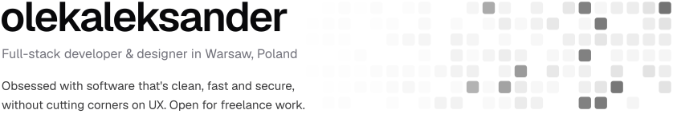
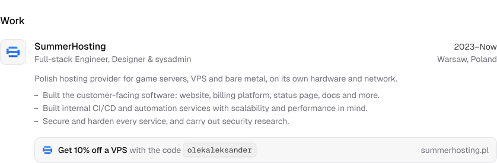

<picture>
  <source media="(prefers-color-scheme: dark)" srcset="assets/banner-dark.svg">
  
</picture>

<a href="mailto:contact@olekaleksander.dev"><picture><source media="(prefers-color-scheme: dark)" srcset="assets/link-contact-dark.svg"></picture></a><a href="https://olekaleksander.dev/?utm_source=github"><picture><source media="(prefers-color-scheme: dark)" srcset="assets/link-website-dark.svg"></picture></a><a href="https://x.com/olekaleksanderr"><picture><source media="(prefers-color-scheme: dark)" srcset="assets/link-x-dark.svg"></picture></a>

<a href="https://summerhosting.pl/?utm_source=github">
<picture>
  <source media="(prefers-color-scheme: dark)" srcset="assets/work-dark.svg">
  
</picture>
</a>

<picture>
  <source media="(prefers-color-scheme: dark)" srcset="assets/stack-dark.svg">
  
</picture>

